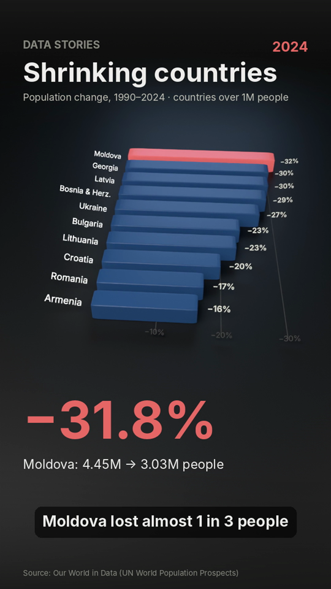
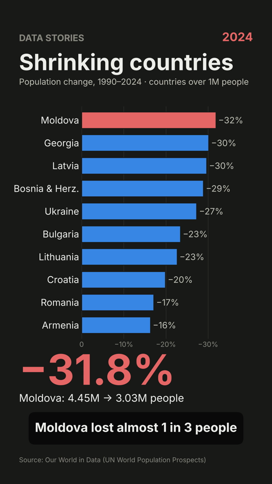
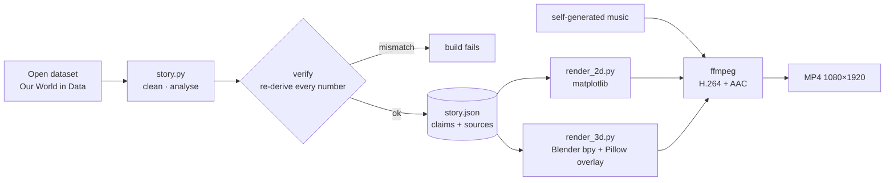

# Data Stories

**Turns real public data into short, verified data-explainer videos, in 2D or 3D (Blender).**

Every number on screen is computed from an open dataset, re-checked by code, and shown with its source.
If the data no longer supports a sentence, the build fails instead of publishing a wrong claim.

| 3D (Blender) | 2D (matplotlib) |
|---|---|
|  |  |

Sample clips: [`docs/sample_3d.mp4`](docs/sample_3d.mp4) · [`docs/sample_2d.mp4`](docs/sample_2d.mp4)
(1080×1920 Shorts format, data: Our World in Data / UN World Population Prospects)

## Quick start

```bash
pip install -r requirements.txt
```

```bash
python make_clip.py --check
```

```bash
python make_clip.py
```

```bash
python make_clip.py --style 3d --quality final
```

`--check` verifies the numbers only. Running with no options renders the 2D clip in about 1 minute. `--style 3d --quality final` renders the 3D clip (EEVEE on a GPU, Cycles on CPU otherwise).

Requires Python 3.13 (for `bpy` 5.2) and ffmpeg. Full setup, render times, and tips for getting
the best output for free are in **[GUIDE.md](GUIDE.md)**.

## How it works



- **One verified story, many renderers.** `story.py` produces `story.json` (series, claims, sources). Renderers only *read* it, so the 2D and 3D versions can never disagree.
- **3D layer + 2D overlay.** Blender renders lit, bevelled bars with a camera move. Pillow draws titles, captions and the headline number on top, so text stays sharp.
- **Engine fallback.** EEVEE is probed in a child process, because without a GPU it can abort the interpreter. If it fails, the scene renders with Cycles on CPU, or with `--engine cycles-gpu` (OptiX/CUDA) on NVIDIA cards.
- **No external assets.** Fonts are bundled (Inter, SIL OFL). Music is synthesised in code. All visuals are generated.

## Tests

```bash
python -m pytest -q
```

The tests cover the verification step:
- tampered numbers are rejected;
- claims that are no longer true ("almost 1 in 3") fail;
- rank order is checked;
- aggregates like "World" and "Europe" are excluded;
- small countries are filtered out;
- every claim carries a source.

## Staying within YouTube's monetization policies

YouTube's July 2026 update demonetizes repetitive, template-based and copied content.
This project is built around the opposite:
- **Original analysis.** Each video is based on a computation that was actually run on a public dataset, with the method and source recorded.
- **Verifiable.** Sources are shown on screen and listed in the description.
- **Human in the loop.** Videos are meant to be reviewed and approved by a person before upload, and uploaded as *private* first.
- **No synthetic people.** There are no realistic AI faces. If an AI voice is used, it should be disclosed with YouTube's altered/synthetic content setting.

## Roadmap

- [ ] Voice: Kokoro TTS or own recording, with word-timed captions
- [ ] More scenes: 3D globe, line ribbon, population pyramid; 16:9 long-form framing
- [ ] Topic agent (Gemini free tier) proposing verifiable questions
- [ ] Streamlit review dashboard (edit, re-render, approve/reject)
- [ ] Publisher: YouTube Data API v3 upload as private with sources in the description
- [ ] Similarity check against past videos

## Data & licences

- Population data: [Our World in Data – CO₂ and Greenhouse Gas Emissions dataset](https://github.com/owid/co2-data) (CC BY 4.0), population from UN World Population Prospects.
- Font: Inter, SIL Open Font License (`fonts/LICENSE-Inter.txt`).
- Music: generated by `write_music()` in `render_3d.py`.
